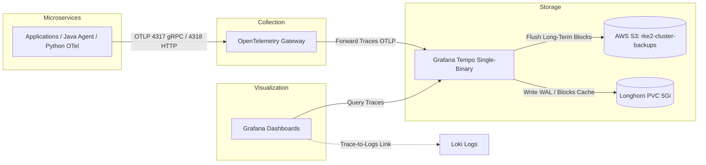

# Grafana Tempo Distributed Tracing Guide

This guide documents the implementation of distributed tracing in the Kubernetes cluster using Grafana Tempo, OpenTelemetry, and S3 backend storage.

---

## 1. Overview & Architecture

Distributed tracing tracks requests end-to-end across multiple microservices (Ingress &rarr; UI &rarr; AI Agent &rarr; FastMCP &rarr; Fineract &rarr; MySQL).



---

## 2. Components Configured

### A. External Secrets (S3 Credentials)
**File:** `advanced/gitops/manifests/secrets/external-secrets.yaml`
Creates `tempo-s3-secret` in the `monitoring` namespace by pulling `AWS_ACCESS_KEY_ID` and `AWS_SECRET_ACCESS_KEY` from Vault (`production-vault` / `s3-backup-keys`).

### B. Tempo Helm Values
**File:** `advanced/gitops/helm-values/monitoring/tempo-values.yaml`
* **Mode:** Single-binary mode (resource-efficient for `t3a.large` nodes).
* **Storage Backend:** AWS S3 (`rke2-cluster-backups-...` bucket) + Longhorn PVC (`5Gi`) for WAL and local block cache.
* **Receivers:** OTLP gRPC (`0.0.0.0:4317`) and OTLP HTTP (`0.0.0.0:4318`).
* **Metrics Generator:** Enabled `metricsGenerator` with `service_graphs`, `span_metrics`, and `local_blocks` processors to support TraceQL metric queries and Grafana trace rate calculations.

### C. Tempo ArgoCD Application
**File:** `advanced/gitops/applications/tempo-app.yaml`
* **Helm Chart:** `grafana/tempo` (version `1.24.4`).
* **Namespace:** `monitoring`.
* **Sync Policy:** Automated sync with prune and self-heal.

### D. Grafana Datasource & Log-Trace Correlation
**File:** `advanced/gitops/helm-values/monitoring/prometheus-values.yaml`
* Added **Tempo** datasource (`http://tempo.monitoring.svc.cluster.local:3200`).
* Added **Derived Fields** in Loki datasource to parse `traceID` or `trace_id` regex and provide direct one-click navigation from Loki log lines into Tempo trace waterfalls.

---

## 3. Deployment Commands & Verification

### Step 1: Deploy ExternalSecret & ArgoCD Application
```bash
# Apply the new external secrets and tempo application
kubectl apply -f advanced/gitops/manifests/secrets/external-secrets.yaml
kubectl apply -f advanced/gitops/applications/tempo-app.yaml
```

### Step 2: Verify S3 Secret Sync
```bash
kubectl get externalsecret tempo-s3-credentials-ext -n monitoring
kubectl get secret tempo-s3-secret -n monitoring
```

### E. OpenTelemetry Gateway Traces Pipeline
**File:** `advanced/gitops/helm-values/logging/otel-gateway-values.yaml`
Configured the `otlp/tempo` exporter and enabled the `traces` pipeline:
```yaml
exporters:
  otlp/tempo:
    endpoint: "tempo.monitoring.svc.cluster.local:4317"
    tls:
      insecure: true

service:
  pipelines:
    logs:
      receivers: [otlp]
      processors: [memory_limiter, batch]
      exporters: [otlphttp]
    traces:
      receivers: [otlp]
      processors: [memory_limiter, batch]
      exporters: [otlp/tempo]
```

---

## 3. Deployment Commands & Verification

### Step 1: Deploy ExternalSecret & ArgoCD Applications
```bash
# Apply secrets and applications
kubectl apply -f advanced/gitops/manifests/secrets/external-secrets.yaml
kubectl apply -f advanced/gitops/applications/tempo-app.yaml
kubectl annotate application otel-gateway -n argocd argocd.argoproj.io/refresh=hard --overwrite
```

### Step 2: Verify S3 Secret Sync
```bash
kubectl get externalsecret tempo-s3-credentials-ext -n monitoring
kubectl get secret tempo-s3-secret -n monitoring
```

### Step 3: Verify Tempo Pod & Service
```bash
kubectl get pods -n monitoring -l app.kubernetes.io/name=tempo
kubectl get svc -n monitoring -l app.kubernetes.io/name=tempo
```

### Step 4: Verify OTLP Receiver Endpoint
Inside the cluster, microservices can send traces to either the central **OTel Gateway** or directly to **Tempo**:
* **OTel Gateway (gRPC):** `otel-gateway-opentelemetry-collector.logging.svc.cluster.local:4317`
* **OTel Gateway (HTTP):** `otel-gateway-opentelemetry-collector.logging.svc.cluster.local:4318`
* **Tempo Direct (gRPC):** `tempo.monitoring.svc.cluster.local:4317`
* **Tempo Query & Metrics API:** `tempo.monitoring.svc.cluster.local:3200`

---

## 4. Application Instrumentation Implementation

### A. Fineract Backend (Java Auto-Instrumentation)
1. **EmptyDir & InitContainer Setup:**
   Since Fineract runs with `readOnlyRootFilesystem: true` and non-root user `10001`, an `initContainer` (`otel-agent-init`) downloads the `opentelemetry-javaagent.jar` into a shared `emptyDir` volume mounted at `/otel`.
2. **Environment Configuration (`values.yaml`):**
   ```yaml
   fineract:
     extraEnv:
       - name: JAVA_TOOL_OPTIONS
         value: "-javaagent:/otel/opentelemetry-javaagent.jar"
       - name: OTEL_SERVICE_NAME
         value: "fineract-backend"
       - name: OTEL_EXPORTER_OTLP_ENDPOINT
         value: "http://otel-gateway-opentelemetry-collector.logging.svc.cluster.local:4317"
       - name: OTEL_EXPORTER_OTLP_PROTOCOL
         value: "grpc"
       - name: OTEL_METRICS_EXPORTER
         value: "none"
       - name: OTEL_LOGS_EXPORTER
         value: "none"
   ```
3. **NetworkPolicy Hardening:**
   Updated `fineract-backend-policy` to permit egress to:
   - `logging` namespace on ports `4317/4318` (OTel Collector).
   - External HTTPS/HTTP (ports `443/80`) to fetch runtime dependencies.

### B. AI Agent & FastMCP Server (Python OpenTelemetry SDK)
1. **Dependencies (`requirements.txt`):**
   - `opentelemetry-api`
   - `opentelemetry-sdk`
   - `opentelemetry-exporter-otlp`
   - `opentelemetry-instrumentation-httpx`
2. **HTTPX & Span Tracing:**
   - Enabled `HTTPXClientInstrumentor().instrument()`, which automatically injects W3C `traceparent` headers into outgoing requests to Fineract and MCP server.
   - Wrapped Gradio conversation turns (`agent_chat_turn`), MCP tool calls (`mcp_tool_call`), and tool executions (`mcp.get_fineract_clients`, `mcp.get_fineract_accounts`, `mcp.get_fineract_loans`, `mcp.query_bank_policies`) in explicit tracer spans.
   - Traces are exported via OTLP gRPC directly to `otel-gateway-opentelemetry-collector.logging.svc.cluster.local:4317`.

---

## 5. End-to-End Distributed Trace Flow

When a user interacts with the system, the full trace spans:
```text
[ai-agent-ui: agent_chat_turn]
  │
  ├── [ai-agent-ui: mcp_tool_call: get_fineract_clients]
  │     │
  │     └── [fineract-mcp-server: mcp.get_fineract_clients]
  │           │
  │           └── [fineract-mcp-server: HTTP GET /clients]
  │                 │
  │                 └── [fineract-backend: GET /fineract-provider/api/v1/clients]
  │                       │
  │                       └── [fineract-backend: SELECT fineract_default.m_client ...]
```

### Viewing Traces in Grafana
1. Open Grafana &rarr; **Explore** &rarr; Select datasource **Tempo**.
2. Run a TraceQL query or search by Service Name:
   - `{ resource.service.name = "fineract-backend" }`
   - `{ resource.service.name = "ai-agent-ui" }`
   - `{ resource.service.name = "fineract-mcp-server" }`
3. Click any Trace ID to inspect span durations, HTTP status codes, SQL queries, and correlated Loki logs!
