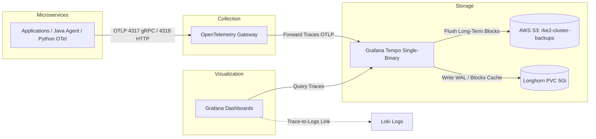

# Grafana Tempo Distributed Tracing Guide

This guide documents the implementation of distributed tracing in the Kubernetes cluster using Grafana Tempo, OpenTelemetry, and S3 backend storage.

---

## 1. Overview & Architecture

Distributed tracing tracks requests end-to-end across multiple microservices (Ingress &rarr; UI &rarr; AI Agent &rarr; FastMCP &rarr; Fineract &rarr; MySQL).



---

## 2. Components Configured

### A. External Secrets (S3 Credentials)
**File:** `advanced/gitops/manifests/secrets/external-secrets.yaml`
Creates `tempo-s3-secret` in the `monitoring` namespace by pulling `AWS_ACCESS_KEY_ID` and `AWS_SECRET_ACCESS_KEY` from Vault (`production-vault` / `s3-backup-keys`).

### B. Tempo Helm Values
**File:** `advanced/gitops/helm-values/monitoring/tempo-values.yaml`
* **Mode:** Single-binary mode (resource-efficient for `t3a.large` nodes).
* **Storage Backend:** AWS S3 (`rke2-cluster-backups-...` bucket) + Longhorn PVC (`5Gi`) for WAL and local block cache.
* **Receivers:** OTLP gRPC (`0.0.0.0:4317`) and OTLP HTTP (`0.0.0.0:4318`).

### C. Tempo ArgoCD Application
**File:** `advanced/gitops/applications/tempo-app.yaml`
* **Helm Chart:** `grafana/tempo` (version `1.24.4`).
* **Namespace:** `monitoring`.
* **Sync Policy:** Automated sync with prune and self-heal.

### D. Grafana Datasource & Log-Trace Correlation
**File:** `advanced/gitops/helm-values/monitoring/prometheus-values.yaml`
* Added **Tempo** datasource (`http://tempo.monitoring.svc.cluster.local:3100`).
* Added **Derived Fields** in Loki datasource to parse `traceID` or `trace_id` regex and provide direct one-click navigation from Loki log lines into Tempo trace waterfalls.

---

## 3. Deployment Commands & Verification

### Step 1: Deploy ExternalSecret & ArgoCD Application
```bash
# Apply the new external secrets and tempo application
kubectl apply -f advanced/gitops/manifests/secrets/external-secrets.yaml
kubectl apply -f advanced/gitops/applications/tempo-app.yaml
```

### Step 2: Verify S3 Secret Sync
```bash
kubectl get externalsecret tempo-s3-credentials-ext -n monitoring
kubectl get secret tempo-s3-secret -n monitoring
```

### Step 3: Verify Tempo Pod & Service
```bash
kubectl get pods -n monitoring -l app.kubernetes.io/name=tempo
kubectl get svc -n monitoring -l app.kubernetes.io/name=tempo
```

### Step 4: Verify OTLP Receiver Endpoint
Inside the cluster, services and the OpenTelemetry Gateway can send traces to:
* **gRPC OTLP:** `tempo.monitoring.svc.cluster.local:4317`
* **HTTP OTLP:** `tempo.monitoring.svc.cluster.local:4318`
* **Query API:** `tempo.monitoring.svc.cluster.local:3100`

---

## 4. Next Steps: OpenTelemetry Routing & App Instrumentation
1. Update `otel-gateway-values.yaml` to route traces to `tempo.monitoring.svc.cluster.local:4317`.
2. Attach OpenTelemetry Auto-Instrumentation to Fineract (Java Agent) and AI Agent (Python OTel SDK).
